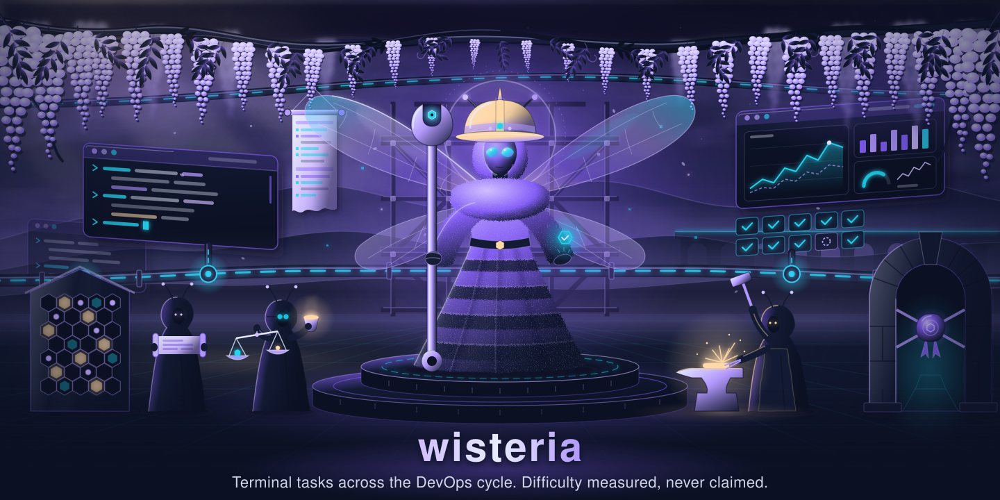

<p align="center"></p>

# Wisteria: samples

<p align="center"><b>Five sample tasks from Wisteria, a Harbor dataset of terminal tasks across the software DevOps cycle.</b></p>

<p align="center"><a href="#summary"></a> <a href="#summary"></a> <a href="#trials"></a></p>

<p align="center"><sub><a href="#abstract">Abstract</a> | <a href="#summary">Summary</a> | <a href="#tasks">Tasks</a> | <a href="#trials">Trials</a> | <a href="#coverage">Coverage</a> | <a href="#dataset-structure">Dataset structure</a> | <a href="#reproduction">Reproduction</a> | <a href="#cite">Cite</a> | <a href="#contact">Contact</a></sub></p>

## Abstract

Wisteria is a dataset of terminal tasks in [Harbor](https://github.com/laude-institute/harbor) format across the software DevOps cycle: build and configuration, monitoring, issue resolving, test generation, and end-to-end pipelines. Its task mix follows [DevOps-Gym](https://arxiv.org/abs/2601.20882) (arXiv:2601.20882), and a task's difficulty comes only from measured frontier-model pass rates.

Every task runs in an offline container and carries a reference solution, a verifier that runs in its own container, and a continuous reward from 0 to 1. Where a task asks for a written root-cause diagnosis, an LLM judge scores it against a rubric, and that score is half of the reward.

This repository holds the five-task sample, drawn from two of those families: issue resolving and test generation. In the three issue-resolving tasks, the agent repairs a real defect in an upstream open source project (NATS Server, fontconfig, or Openraft) and writes a root-cause diagnosis. In the two test-generation tasks, it writes Go tests that accept every correct fix and reject every incorrect fix in a hidden pool of implementations. The sample covers Go, C, and Rust. Each task derives from a public upstream change, recorded in its `task.toml`. Task images hold no upstream version history, the environment has no network access, the agent can reach only the model API hosts, and agent web search is disabled, so the upstream fix is out of reach.

## Summary

| Property | Value |
| --- | --- |
| Tasks | 5 |
| Domain | Software engineering (issue resolving and test generation) |
| Languages | Go, C, Rust |
| Format | Harbor task, schema 1.4 |
| Platforms | linux/amd64, linux/arm64 |
| Reward | Continuous, 0 to 1 |
| Agent | Codex CLI 0.166.0 with `gpt-6.1-sol` |
| Judge | Claude Sonnet 5.5 |
| Trials per task | 1 |
| Mean reward | 0.4780 |

## Tasks

| Task | Project | Language | Objective | Family |
| --- | --- | --- | --- | --- |
| [`62e0ebab`](62e0ebab-8172-524e-8775-270d4317e359/) | NATS Server (`nats-io/nats-server`) | Go | Repair the JetStream server so a durable flow-controlled consumer stops feeding a mirror and a source stale deliveries after a consumer leader change and reset, and write a root-cause diagnosis. | Issue resolving |
| [`b2740a36`](b2740a36-1280-5dfe-a481-cee0ba4dd4ea/) | fontconfig 2.18.3 (development) | C | Make fontconfig use font caches written by releases from 2.17.0 on as they are, without rewriting them, so host fonts cached by an older fontconfig are listed inside a Flatpak sandbox running a newer one, with generic-family matching unchanged, and write a root-cause diagnosis. | Issue resolving |
| [`b4321f39`](b4321f39-1196-5335-9087-ad4c9a0fba23/) | NATS Server (`nats-io/nats-server`) | Go | Write Go tests for `server/stree`, the server's subject tree, around wildcard characters inside a token, that accept every correct fix and reject every incorrect fix in a hidden pool of implementations. | Test generation |
| [`dba14210`](dba14210-8a3b-5c67-8beb-c715e9c75627/) | OpenTelemetry Collector Contrib (`k8sattributes` processor) | Go | Write Go tests that tell correct fixes of a pod-cache leak in the `k8sattributes` processor from incorrect ones. | Test generation |
| [`e76c575e`](e76c575e-bb1a-5f7d-ba7d-a2497cae31e1/) | Openraft 0.10.0-alpha.37 | Rust | Make a node that was leader before a crash regain leadership only through a fresh election in a higher term, so a log id lost from its unflushed log is never reused for a different entry and followers cannot silently diverge, and write a root-cause diagnosis. | Issue resolving |

## Trials

Each task was run once on 2026-11-14 using Codex CLI 0.166.0 with `gpt-6.1-sol`, and scored by the task's own verifier. Each trial is stored in its task's `trials/gpt-6.1-sol/`.

| Task | Reward | Cost (USD) | Agent time |
| --- | ---: | ---: | ---: |
| [`62e0ebab-8172-524e-8775-270d4317e359`](62e0ebab-8172-524e-8775-270d4317e359/trials/gpt-6.1-sol/) | 0.3750 | 1.91 | 38m 33s |
| [`b2740a36-1280-5dfe-a481-cee0ba4dd4ea`](b2740a36-1280-5dfe-a481-cee0ba4dd4ea/trials/gpt-6.1-sol/) | 0.5321 | 0.41 | 7m 33s |
| [`b4321f39-1196-5335-9087-ad4c9a0fba23`](b4321f39-1196-5335-9087-ad4c9a0fba23/trials/gpt-6.1-sol/) | 0.5333 | 0.19 | 3m 29s |
| [`dba14210-8a3b-5c67-8beb-c715e9c75627`](dba14210-8a3b-5c67-8beb-c715e9c75627/trials/gpt-6.1-sol/) | 0.5806 | 0.13 | 1m 41s |
| [`e76c575e-bb1a-5f7d-ba7d-a2497cae31e1`](e76c575e-bb1a-5f7d-ba7d-a2497cae31e1/trials/gpt-6.1-sol/) | 0.3690 | 0.58 | 10m 9s |
| **mean** | **0.4780** | **0.64** | **12m 17s** |

Agent time is the span of the Codex session.

Each trial folder holds:

| Path | Contents |
| --- | --- |
| `result.json` | Agent, model, reward, token usage, and cost |
| `agent/` | Agent trajectory (`trajectory.json`), Codex session transcript (`sessions/`), and agent output (`codex.txt`) |
| `verifier/` | `reward.json`, `reward.txt`, `reward-details.json`, a CTRF test report (`ctrf.json`), and test output |
| `artifacts/` | Files the agent produced, collected from the paths declared in `task.toml` |

## Coverage

| Keyword | Tasks |
| --- | --- |
| bug-fix | 2 |
| c | 1 |
| cache | 1 |
| compatibility | 1 |
| consensus | 1 |
| consumer-reset | 1 |
| crash-recovery | 1 |
| flatpak | 1 |
| flow-control | 1 |
| fontconfig | 1 |
| fonts | 1 |
| go | 2 |
| jetstream | 1 |
| kubernetes | 1 |
| leader-election | 1 |
| memory-leak | 1 |
| mirror | 1 |
| nats | 1 |
| nats-server | 1 |
| openraft | 1 |
| opentelemetry-collector | 1 |
| race-detector | 1 |
| radix-tree | 1 |
| raft | 1 |
| rewardkit | 1 |
| rust | 1 |
| source | 1 |
| test-generation | 2 |

## Dataset structure

Each task is one Harbor task in a directory named by its uuid.

| Task | Keywords |
| --- | --- |
| [`62e0ebab-8172-524e-8775-270d4317e359`](62e0ebab-8172-524e-8775-270d4317e359/) | consumer-reset, flow-control, jetstream, mirror, nats, source |
| [`b2740a36-1280-5dfe-a481-cee0ba4dd4ea`](b2740a36-1280-5dfe-a481-cee0ba4dd4ea/) | bug-fix, c, cache, compatibility, flatpak, fontconfig, fonts |
| [`b4321f39-1196-5335-9087-ad4c9a0fba23`](b4321f39-1196-5335-9087-ad4c9a0fba23/) | go, nats-server, race-detector, radix-tree, test-generation |
| [`dba14210-8a3b-5c67-8beb-c715e9c75627`](dba14210-8a3b-5c67-8beb-c715e9c75627/) | go, kubernetes, memory-leak, opentelemetry-collector, rewardkit, test-generation |
| [`e76c575e-bb1a-5f7d-ba7d-a2497cae31e1`](e76c575e-bb1a-5f7d-ba7d-a2497cae31e1/) | bug-fix, consensus, crash-recovery, leader-election, openraft, raft, rust |

```
<uuid>/
├── task.toml         runner manifest
├── instruction.md    objective the agent reads
├── environment/      sandbox image
├── tests/            verifier, hidden from the agent
├── solution/         reference solution
└── trials/
    └── gpt-6.1-sol/      agent model, one trial
        ├── result.json   reward, usage, and cost
        ├── agent/        trajectory and Codex session
        ├── verifier/     reward and test reports
        └── artifacts/    files the agent produced
```

## Reproduction

Each task directory is a complete Harbor task: `task.toml` is the runner manifest, `instruction.md` the objective, `environment/` the sandbox image, `tests/` the verifier, and `solution/` the reference solution. To run a task with the agent and model used for the trials above:

```bash
harbor run -p <uuid> -a codex -m openai/gpt-6.1-sol
```

The verifier's LLM judge uses `ANTHROPIC_API_KEY` (Claude Sonnet 5.5) or, when only `OPENAI_API_KEY` is set, an OpenAI judge. `b4321f39` uses the Anthropic judge only.

## Cite

```bibtex
@misc{wisteria2026,
  title        = {Wisteria: Harbor-format terminal tasks across the DevOps cycle},
  author       = {{Ethara.AI}},
  year         = {2026}
}
```

## Contact

Wisteria DevOps-Gym is built by [Ethara.AI](https://github.com/Ethara-Ai). For questions about the benchmark or dataset, contact [research@ethara.ai](mailto:research@ethara.ai).

Copyright (c) 2026 Green Rider Technology LLP (Ethara AI). All rights reserved.
